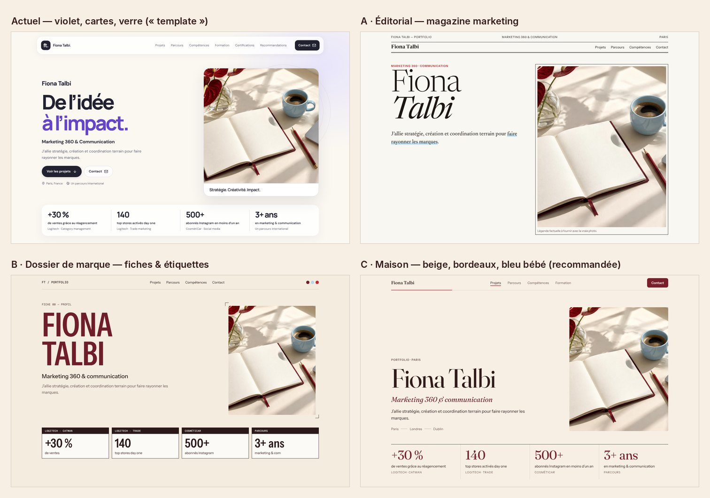

# Audit UI/UX du portfolio — octobre 2026

Audit du site tel qu'il est au commit `79c4ea9`, avant toute modification. Il sert de feuille de route pour l'implémentation.

**Méthode.** Sept angles audités séparément : direction artistique, parcours du lecteur, mobile/tablette/desktop, interactions, accessibilité, performance/SEO et vidéo de présentation. Chaque angle a été testé dans un vrai navigateur sur une vingtaine de formats, de 320 px au 1920 px, portrait et paysage. Un second relecteur a ensuite contre-vérifié chaque constat pour écarter les erreurs et les idées excessives : sur 139 constats, 5 ont été écartés, 87 corrigés et 15 ajoutés.

- Le détail technique de chaque constat (preuve, problème, recommandation) est dans [`audit/annexe-constats-verifies.md`](audit/annexe-constats-verifies.md).
- Les maquettes des trois pistes visuelles sont dans [`audit/pistes-direction-artistique.jpg`](audit/pistes-direction-artistique.jpg) et [`audit/mobile-actuel-vs-maison.jpg`](audit/mobile-actuel-vs-maison.jpg).

Légende : 🔴 critique · 🟠 important · 🟡 amélioration · ⚪ bonus. Effort : **S** = moins d'une heure, **M** = une demi-journée, **L** = plus.

---

## 1. En bref

Le site est **propre, rapide et techniquement sain** : aucun débordement, cibles tactiles de 44 px, contenu lisible sans JavaScript, contrastes presque tous conformes, une seule erreur relevée par l'outil d'accessibilité axe. Le problème n'est pas la qualité, c'est la **personnalité**.

Aujourd'hui, le site ressemble à un gabarit généré :

- violet par défaut des outils IA ;
- cartes arrondies partout, icônes dans des carrés ;
- titres-slogans en deux temps (« X. Y. ») ;
- photo de bureau générique.

Un recruteur pressé retient un slogan, pas Fiona. Sur la plupart des portables, il ne voit même pas les chiffres clés sans défiler.

Les **5 chantiers qui changeront le plus la perception** :

1. **Une identité qui est la sienne.** Revenir au brief d'origine (beige, bordeaux, bleu bébé, rouge cerise), avec une typographie qui a du caractère, et retirer les ornements de gabarit.
2. **Un hero qui dit qui, quoi, où, et le prouve.** Le nom en titre principal, une phrase factuelle avec les employeurs, et les 4 chiffres visibles sans défiler sur portable comme sur téléphone.
3. **Des projets lisibles d'un coup d'œil.** Des fiches « Enjeu / Action / Résultats » entièrement visibles, au lieu de missions cachées derrière quatre « Voir les missions ».
4. **Des clics qui répondent.** Aujourd'hui, un tap sur mobile ne donne **aucun** retour visuel. Il faut aussi corriger le menu mobile, qui laisse passer les taps vers le contenu en dessous, et les petits sauts de mise en page.
5. **La vidéo de présentation**, proposée sans rien imposer, avec une pastille « plus tard » en bas à droite. Elle devient l'élément le plus personnel du site.

---

## 2. Ce qui fonctionne déjà (à garder)

- Contenu centralisé et typé dans `src/data/portfolio.ts`, séparé de l'affichage : on peut changer tout le design sans toucher aux faits.
- Chiffres clés réels, issus du brief, affichés avant la photo sur mobile.
- Aucun débordement horizontal ni aucune cible tactile sous 44 px, sur les 20 formats testés.
- Page pré-rendue, entièrement lisible sans JavaScript. Le menu mobile fonctionne même sans JS.
- Défilement fluide : la barre de progression et le lien actif sont calculés une fois par image, sans écouteur bloquant. Aucune image au-dessus de 33 ms même avec un processeur ralenti ×4.
- Mise en page stable au chargement (CLS ≈ 0), aucune erreur console ni d'hydratation.
- `prefers-reduced-motion` respecté, contours de focus visibles et jamais rognés, lien d'évitement fonctionnel.
- Recommandations sans message d'attente, avec ouverture du PDF prévue et testée.
- Bouton « Contact » et barre de progression toujours visibles sur mobile et tablette.

---

## 3. Pourquoi le site fait encore « template IA »

| Signal                                                                     | Où                                                                                 | Pourquoi ça se voit                                                                                                                                     |
| -------------------------------------------------------------------------- | ---------------------------------------------------------------------------------- | ------------------------------------------------------------------------------------------------------------------------------------------------------- |
| Violet saturé et neutres lavande                                           | `styles.css:50-63`, 47 couleurs codées en dur                                      | C'est la couleur par défaut de Lovable, shadcn et Tailwind UI. Elle est hors brief et jure avec la seule photo du site, qui est bordeaux et bleu clair. |
| Deux polices sans-serif presque jumelles (DM Sans + Manrope), très serrées | `styles.css:4-5`, `-0.073em`                                                       | Aucun contraste typographique. 17 tailles et 9 graisses différentes, sans échelle.                                                                      |
| Header en pilule de verre flottante                                        | `styles.css:124-141`                                                               | Poncif 2023-2025. Il est aussi plus large que la grille du contenu (1220 px contre 1180 px).                                                            |
| Titres en deux temps avec 2ᵉ ligne grise, sur chaque section               | « De l'idée / à l'impact. », « La curiosité comme moteur. / L'impact comme cap. »… | Le parallélisme « X. Y. » est le tic d'écriture le plus reconnaissable des textes générés. La ligne grise ressemble à du texte désactivé.               |
| Badges numérotés « 01 » à « 07 » et numéros de projet                      | `section-heading.tsx`, `project-card.tsx:19`                                       | Ornement sans information. Les numéros de projet échouent aussi au contraste (3,3:1).                                                                   |
| 22 cartes arrondies, 19 icônes dans des carrés lavande, pilules            | compétences, formation, certifications, outils                                     | C'est le composant shadcn par excellence, répété au point de faire catalogue.                                                                           |
| Halos, orbites et cercles décoratifs                                       | `.hero::before`, `.visual-orbit`, `.cover-rings`, panneau contact                  | La décoration « glow & orbit » des gabarits.                                                                                                            |
| Photo de bureau avec la légende « Stratégie. Créativité. Impact. »         | `hero.tsx`                                                                         | Rien ne parle de Fiona.                                                                                                                                 |
| Faux logos : « logitech. » avec un point, monogrammes « LW », « S », « G » | `brands`, certifications                                                           | Ils imitent des logotypes, avec un risque d'usage de marque. Un organisme a même été inventé : « AI Product Building — Intelligence artificielle ».     |

> **Point de vigilance relevé à la contre-vérification** : en 2026, « fond crème + grande serif + filets fins » devient lui aussi un style par défaut des pages générées. Changer la palette ne suffit pas. L'originalité doit venir (1) de détails propres au métier de Fiona : KPI en « étiquettes de rayon », fiches de campagne, chiffres qui mènent aux projets ; (2) de ses vrais matériaux : sa vidéo, son portrait, les visuels de ses projets, éventuellement ses dessins. Elle ne doit pas venir d'effets.

---

## 4. Direction artistique



Les trois pistes ont été rendues avec les vraies polices. Tous les couples texte/fond passent le niveau AA (calcul refait indépendamment par le relecteur).

|           | **A · Éditorial**                                                              | **B · Dossier de marque**                                                                        | **C · Maison** (recommandée)                                                                                    |
| --------- | ------------------------------------------------------------------------------ | ------------------------------------------------------------------------------------------------ | --------------------------------------------------------------------------------------------------------------- |
| Idée      | Un numéro de magazine marketing : couverture, sommaire, articles-cas           | Une charte de marque et des fiches campagne, dans le vocabulaire de son métier (brief, PLV, KPI) | Luxe discret et chaleureux, fidèle au brief, au service des chiffres                                            |
| Palette   | Blanc cassé, encre, cerise, bleu bébé en surlignage, bordeaux pour le contact  | Beige, bordeaux, bleu bébé, cerise en signal                                                     | **Beige uni**, encre chaude, **bordeaux** en accent, **bleu bébé** pour les surfaces, **cerise** en ponctuation |
| Typo      | Newsreader + Instrument Sans                                                   | Instrument Sans condensée en capitales + une mono                                                | **Fraunces** (serif à axe optique) + **Instrument Sans**                                                        |
| Signature | Folio en tête, surlignage « au feutre »                                        | KPI en étiquettes de rayon, repères de coupe                                                     | Le nom en grand, KPI en étiquettes de rayon (repris de B), « Paris · Londres · Dublin »                         |
| Risques   | Registre plus « culture » que retail ; KPI poussés sous la ligne de flottaison | Peut paraître froid, technique ou « affiche »                                                    | Peut faire « faire-part » si l'on abuse de la serif                                                             |

**Recommandation : C « Maison », avec les fiches projet et les étiquettes KPI de B.** Pourquoi :

- c'est fidèle au brief (beige, bordeaux, bleu bébé, cerise) et cohérent avec la photo actuelle ;
- la serif et le bordeaux parlent au luxe (MSc GCU), les fiches Enjeu / Action / Résultats parlent au retail et à la tech (Logitech, CosmétiCar) ;
- on garde les mêmes sections, les mêmes ancres et les mêmes composants : les changements portent sur le CSS et quelques champs de données.

**Garde-fous issus de la contre-vérification :**

- **Pas d'italique.** Les maquettes en contiennent, ce n'est pas le choix retenu.
- **Fraunces réservée** au nom, aux titres de section, aux chiffres clés et à l'e-mail. Tout le reste est en Instrument Sans.
- **Pas de petites capitales espacées partout** : en casse normale, c'est plus humain.
- Le brief demande des **KPI en blocs visuels**, des **certifications en badges** et une **timeline**. On les garde sous une forme sobre :
  - KPI sur un aplat bleu bébé très clair (`--sky-soft`), qui donne aussi au bleu un vrai rôle ;
  - certifications en badges compacts d'une ligne ;
  - timeline datée dès que les dates sont fournies.
- **Sur mobile, les chiffres restent avant la photo.** La maquette mobile ne le respecte pas, il faudra la corriger à l'implémentation.
- **Le nom en H1 doit précharger sa police**, avec une police de repli calibrée, sinon il « saute » au chargement.

**Tokens proposés** (extrait ; liste complète dans l'annexe, section Direction artistique) :

```css
--paper: oklch(0.955 0.017 78); /* #f7efe4 fond beige uni */
--paper-deep: oklch(0.928 0.024 74); /* #f1e5d6 bandes alternées */
--paper-light: oklch(0.982 0.008 82); /* #fcf9f3 surfaces */
--ink: oklch(0.25 0.035 22); /* #311b1a texte, 14,2:1 */
--ink-soft: oklch(0.48 0.032 32); /* #6f5752 texte secondaire, 5,8:1 */
--bordeaux: oklch(0.39 0.125 17); /* #7a1e2c accent, 9:1 */
--bordeaux-deep: oklch(0.31 0.095 17); /* #56161e bloc contact */
--sky: oklch(0.875 0.05 232); /* #b6dcf2 bleu bébé (surfaces, sélection) */
--sky-soft: oklch(0.95 0.022 232); /* #e1f2fb aplat des KPI */
--cherry: oklch(0.555 0.205 24); /* #d02331 barre de progression, lien actif */
--line: oklch(0.86 0.02 68); /* #dacfc3 filets */
/* Rayons : 4 px (surfaces), 8 px (boutons) ; une seule ombre, pour le widget vidéo. */
```

Constats de cet angle (détail dans l'annexe) :

- **Palette et thème :** 🔴 DA-01 palette hors brief.
- **Typographie et titres :** 🟠 DA-02 nom en H1, 🟠 DA-03 typographie, 🟠 DA-04 titres-slogans.
- **Ornements et logos :** 🟠 DA-05 numérotation, 🟠 DA-06 ornements de kit UI, 🟠 DA-07 faux logos, 🟠 DA-09 halos.
- **Hero et header :** 🟠 DA-08 visuel générique, 🟠 DA-10 header.
- **Projets et chiffres :** 🟠 DA-11 couvertures pastel, 🟠 DA-12 KPI.
- **Identité hors du site :** 🟠 DA-20 identité absente des partages.
- **Contenus :** 🟠 DA-21 timeline sans dates et contenus inventés, 🟡 DA-V2 slogans résiduels.
- **Détails visuels :** 🟡 DA-13 rythme vertical, 🟡 DA-14 en-têtes de section, 🟡 DA-15 rayons et ombres.
- **Code et interactions :** 🟡 DA-16 couleurs codées en dur, 🟡 DA-17 survols décoratifs, 🟡 DA-18 bloc contact.
- **Typographie de détail :** 🟡 DA-19 typographie française, 🟡 DA-V1 saut du titre.
- **Mise en page :** 🟡 DA-22 compétences sur tablette, 🟡 DA-V3 KPI cliquables.
- **Bonus :** ⚪ DA-23 touches personnelles.

---

## 5. Constats par thème

Les doublons entre angles sont fusionnés sous un seul identifiant ; les autres identifiants sont cités entre parenthèses.

### 5.1 Parcours du lecteur & contenus

**Ce que voit un recruteur aujourd'hui** :

- **en 10 s** : un slogan, la photo d'un bureau et, sur portable, aucun chiffre ;
- **en 60 s** : sept titres-formules qui ne disent pas ce que contient chaque section ;
- **en 3 min** : quatre accordéons à ouvrir, aucune date, aucun auteur de recommandation, LinkedIn tout en bas.

- 🔴 **UX-01 · Le slogan prend la place du nom et de la proposition de valeur** (DA-02, A11Y-07) · tous · S
  « Fiona Talbi » n'est qu'un paragraphe ; le H1 est « De l'idée à l'impact. » ; Logitech n'apparaît qu'en 12 px gris.
  → H1 = « Fiona Talbi », puis le métier, puis une phrase factuelle avec les employeurs, reprise du brief : « Plus de trois ans de marketing entre la marque et le terrain : category management et trade marketing chez Logitech, réseaux sociaux chez CosmétiCar, relations influenceurs chez Massilia E-consulting. » Ensuite une ligne formation (« Diplômée d'un Master Marketing Digital & Innovation (IÉSEG) et d'un MSc Luxury Marketing (GCU Londres) ») et une ligne langues.
- 🔴 **UX-02 · Les chiffres clés sont sous la ligne de flottaison sur les portables** (RT-05, UX-V1) · desktop, tablette, mobile · M
  Mesuré dans un vrai navigateur (barre d'adresse déduite) : la bande de KPI est coupée de 78 à 211 px à 1366×657, 1440×790 et 1536×730. Sur un iPhone réel (≈ 390×664), seuls 2 KPI sur 4 sont visibles.
  → Hero compact sur desktop, et KPI juste après les boutons sur mobile, la formation et les langues passant dessous. Critère d'acceptation : les 4 chiffres visibles à 1280×720, 1366×657 et 390×664.
- 🟠 **UX-03 · Ce que Fiona a fait est caché derrière « Voir les missions »** (DA-11, MO-04, RT-09) · tous · M
  La partie visible montre des chiffres sans dire le rôle. Ouvrir une carte ajoute 163 px d'un coup et crée un trou de 257 px dans la grille.
  → Fiches **entièrement visibles** sur une colonne : marque et catégorie, titre, Enjeu (contexte), Action (mission, à la 1ʳᵉ personne), puis les 2 chiffres. Plus d'accordéon, ce qui règle aussi l'animation et l'alignement.
- 🟠 **UX-04 · Titres et accroches en slogans** (DA-04, A11Y-06, DA-V2) · tous · S
  → Titres factuels, réécrits à partir des faits du README. Bannir « impact », « rayonner » et les paires « X. Y. ». Toute réécriture est soumise à Fiona avant publication (table de propositions dans l'annexe, UX-04 et extra UX).
- 🟠 **UX-V3 · Intitulés de poste et lieux sans source** · tous · S
  « Marketing Manager Assistant », « Chargée de communication » et les lieux viennent d'une génération Lovable, pas du brief.
  → **À faire confirmer par Fiona** avant de les mettre en avant.
- 🟠 **UX-07 · Parcours sans dates** (DA-21) · tous · M
  Une timeline sans dates est un décor vide, et elle ne permet pas de croire « 3+ ans ».
  → Champs `period` et `contract` à fournir. En attendant, une liste sobre ; la timeline datée arrive avec les dates.
- 🟠 **UX-08 · Formation isolée et trop bas** · tous · S
  → Fusion dans Parcours (l'ancre `#formation` est conservée), une ligne par diplôme. Le semestre à Dublin garde sa propre ligne : le rattacher à l'ESSCA serait inventer.
- 🟠 **UX-15 · Certifications : faux monogrammes, organisme inventé, TOEIC en double** (DA-07, DA-21) · tous · S
  → Badges compacts d'une ligne. Organisme vide tant que Fiona ne l'a pas donné. Le TOEIC reste dans Langues. Logos uniquement s'ils sont fournis et autorisés.
- 🟠 **UX-10 · Recommandations anonymes** (A11Y-09) · tous · S
  → Champs optionnels auteur, fonction, organisation et extrait, uniquement avec l'accord du recommandant. Libellé « Demander la lettre par e-mail ».
- 🟠 **UX-12 · Sorties mal placées** · tous · S
  « Contact » apparaît trois fois dans le premier écran mobile, LinkedIn n'arrive qu'à 95 % de la page, et il n'y a pas de CV.
  → Retirer le « Contact » du hero (le header suffit) et le remplacer par l'entrée vidéo (§6). LinkedIn dans le contact et le pied de page. CV en PDF si Fiona le fournit.
- 🟠 **UX-06 · Poste recherché et disponibilité absents** · tous · S
  → Champs `seeking` et `availability` à fournir. Rien ne s'affiche tant qu'ils sont vides.
- 🟠 **UX-14 · Mobile : 10 écrans, dont un tiers de contenu secondaire en cartes** · mobile · M
  → Avec les fusions, environ 6 100 px au lieu de 8 558, missions visibles comprises.
- 🟠 **UX-16 · Aucun visuel réel** · tous · M
  → Emplacements prévus dans les données (portrait, un visuel par projet), vides par défaut et sans cadre vide.
- 🟡 **UX-05 · KPI répétés sans lien avec les projets** (DA-V3) · tous · S
  → Chaque chiffre devient un lien vers sa fiche projet (flèche ↓, jamais ↗). La fiche est brièvement mise en valeur à l'arrivée. La répétition devient voulue.
- 🟡 **UX-11 · Navigation à 7 entrées sur deux niveaux** · tous · M
  → Après les fusions : Projets · Parcours · Compétences · Recommandations + Contact. Menu à un seul niveau. Le lien Recommandations reste visible.
- 🟡 **UX-09 · Compétences génériques** · tous · M
  → Trois groupes en texte, sans cartes ni icônes, avec les outils en une ligne. Ne pas relier outils et projets sans source.
- 🟡 **UX-17 · Bandeau de marques redondant** · tous · S → supprimé, puisque les entreprises sont dans la phrase du hero.
- 🟡 **UX-18 · Pied de page sans sortie** · tous · S → « Fiona Talbi · Paris — e-mail — LinkedIn ↗ — Haut de page ↑ ».
- 🟡 **UX-19 · Numérotation des sections** · tous · S → supprimée.
- 🟡 **UX-20 · Typographie française et jargon** (DA-19) · tous · S → espaces fines insécables avant % ? ! :, et explication au premier usage de « catman » et « day one ».
- ⚪ **UX-22 · Version anglaise** · L → plus tard, une fois la traduction validée par Fiona.
- ⚪ **UX-23 · Se démarquer par du contenu réel** · M → vidéo, phrases à la 1ʳᵉ personne, visuels de projets, dessins si Fiona le souhaite.

### 5.2 Mobile, tablette, desktop

- 🟠 **RT-01 · Toucher à côté du menu mobile déclenche aussi l'élément dessous** (MO-05) · mobile, tablette · S
  Vu à 768 et 390 px : le menu se ferme **et** un projet s'ouvre.
  → Voile léger sous le menu ouvert, entrée animée en 200 ms, page bloquée derrière.
- 🟠 **RT-07 · Survols « collants » au toucher et aucun retour au tap** (MO-01, MO-02) · mobile, tablette · S
  → Voir §5.3. C'est le point n°1 de « chaque clic satisfaisant ».
- 🟠 **RT-02 · Au clavier, le focus sort du menu ouvert et se cache dessous** (A11Y-01) · tous · S → fermer le menu quand le focus le quitte.
- 🟡 **RT-03 · « Recommandations » allume « Contact »** sur iPad portrait · tablette · S → règle de fin de page corrigée (`use-portfolio-navigation.ts:41-44`).
- 🟡 **RT-04 · Arrivée des ancres trop basse et irrégulière** · tous · S
  Le titre arrive 68 à 90 px sous le header, mais 26 px pour Formation.
  → Écart uniforme d'environ 20 px. Corriger les règles en place, car l'ajout proposé en fin de fichier cassait Formation.
- 🟡 **RT-06 · Paysage téléphone : le header prend 24 % de la hauteur** · mobile · S → header compact (66 px) sous 500 px de haut, sans refaire tout le hero.
- 🟡 **RT-08 · Tablette : panneau de menu étiré sur 720 px** · tablette · S → panneau compact aligné à droite (340 px). La navigation en ligne arrive avec les 4 liens d'UX-11.
- 🟡 **RT-11 · 47 textes de 12 px ou moins sur mobile** · mobile · S → 13 px minimum pour tout texte informatif.
- 🟡 **RT-13 · Le lien « Retour en haut » est exactement sous la future pastille vidéo** · mobile, tablette · S → la pastille se cache quand le pied de page est visible (§6).
- 🟡 **RT-10 · Puces des compétences mal alignées sur tablette** · tablette · S → résolu par la refonte des compétences en texte.
- 🟡 **RT-V1 · Plusieurs contrôles sans aucun survol** (MO-12) · desktop · S → voir §5.3.
- ⚪ **RT-14** palier 560-720 px · ⚪ **RT-15** recadrage de la photo (à faire avec la vraie photo) · ⚪ **RT-16** ouverture animée · ⚪ **RT-17** boutons de contact pleine largeur sur mobile.
- ~~RT-12 `viewport-fit=cover`~~ **écarté** : sans cette option, iOS garde déjà la page dans la zone sûre. L'ajouter créerait du travail sans bénéfice.

### 5.3 Interactions & mouvement (« chaque clic satisfaisant »)

Le mouvement actuel est sobre et sain. Le problème, c'est que **l'interaction est muette** : aucun état `:active` dans tout le CSS, et le surlignage natif du tap est supprimé. Sur 15 éléments testés, **aucun** ne réagit à la pression. Il manque aussi un système cohérent : 6 durées et 3 courbes différentes.

**Système de mouvement proposé** (minimal, rien de spectaculaire) :

- **3 durées** : 120 ms (pression), 200 ms (survol, couleurs, retours), 400 ms (ouvertures, apparitions). L'entrée du hero garde ses 550 ms.
- **2 courbes** : sortie douce (celle d'aujourd'hui), plus une courbe d'accélération pour les fermetures.
- **Pression** : `scale: 0.97`, instantanée, avec retour en 120 ms ; `0.92` pour les boutons-icônes de 44 px. On utilise la propriété `scale`, pas `transform`, pour ne pas casser la rotation du « + ».
- **Survols** réservés aux souris (`@media (hover: hover) and (pointer: fine)`). Au toucher : pression et focus uniquement.
- **Seuls les éléments cliquables réagissent.**
- Animations uniquement en `opacity` et `transform`. `prefers-reduced-motion` est strictement respecté.

| Constat                                                                                              | Gravité | Correction                                                                                                             |
| ---------------------------------------------------------------------------------------------------- | ------- | ---------------------------------------------------------------------------------------------------------------------- |
| **MO-01** Aucun état pressé, tap muet                                                                | 🟠      | Pression sur boutons, liens du menu, copier, burger ; fond pressé un cran plus sombre que le survol sur la nav desktop |
| **MO-02** Survols non réservés à la souris (soulèvement de 2 px collé après un tap)                  | 🟠      | `@media (hover: hover)` partout                                                                                        |
| **MO-05** Menu mobile qui apparaît sèchement, sans voile, page qui défile dessous                    | 🟠      | Entrée en 200 ms depuis le coin, voile, défilement bloqué                                                              |
| **MO-06** Le lien actif passe en gras et décale toute la nav de 6 px                                 | 🟠      | Supprimer le gras ; l'état actif passe par la couleur                                                                  |
| **MO-09** Au rechargement en milieu de page, 8 blocs déjà visibles disparaissent puis réapparaissent | 🟠      | N'animer que les blocs situés sous l'écran au chargement                                                               |
| **MO-03** Survol des boutons : soulèvement et ombre violette « template »                            | 🟡      | Changement de fond seul ; la flèche glisse de 2 px dans sa direction                                                   |
| **MO-08** Le lien actif disparaît en arrivant sur Contact                                            | 🟡      | Le bouton Contact du header prend l'état actif                                                                         |
| **MO-10** Lien partagé vers `#projets` : la page s'affiche en haut puis défile en animation          | 🟡      | Défilement doux activé au premier geste de l'utilisateur, jamais au chargement                                         |
| **MO-12 / RT-V1** Logo, Contact du header, liens texte sans survol                                   | 🟡      | Survols sobres (couleur, soulignement)                                                                                 |
| **MO-13** Les pilules d'outils, non cliquables, réagissent au survol                                 | 🟡      | Supprimé                                                                                                               |
| **MO-14** Après un clic, la carte projet reste « sélectionnée »                                      | 🟡      | Mise en valeur au clavier uniquement                                                                                   |
| **MO-15** Copier l'e-mail : retour minimal                                                           | 🟡      | Coche en fondu, bouton teinté 2,5 s, statut annoncé. Le message d'erreur ne s'efface pas                               |
| **MO-17** Bloc reduced-motion à compléter pour les nouveaux éléments                                 | 🟡      | Règles séparées (ne jamais mettre `::details-content` dans une liste de sélecteurs)                                    |
| **PERF-03** Le hero part d'une opacité 0 et retarde l'affichage du titre d'environ 550 ms            | 🟡      | Titre et visuel visibles dès le premier rendu, léger glissement seulement                                              |
| **MO-07** Pendant un clic de nav, l'indicateur traverse toutes les sections                          | ⚪      | Indicateur verrouillé sur la cible                                                                                     |
| **MO-11** Tokens de mouvement                                                                        | ⚪      | Voir le système ci-dessus                                                                                              |
| **MO-16** L'e-mail saute de 28 px à l'hydratation                                                    | ⚪      | Réserver la place du bouton copier                                                                                     |
| **MO-V2** Le fondu de section se termine après la fin du défilement                                  | ⚪      | Seulement si MO-07 est fait                                                                                            |

### 5.4 Accessibilité (WCAG 2.2 AA)

Socle nettement au-dessus de la moyenne. À corriger :

- 🟠 **A11Y-01** Focus qui sort du menu mobile ouvert (= RT-02) · S
- 🟠 **A11Y-03** Liens de la nav desktop à 3,1:1 quand la photo passe sous le header translucide · S → **réglé par le header opaque** de la nouvelle direction (DA-10). Sinon : encre plus dense et verre à 86 %.
- 🔴 **A11Y-18 Vidéo** : exigences à intégrer dès la conception (§6) · M
- 🟡 **A11Y-02** Numéros de projet à 3,3:1 → réglé par leur suppression (DA-05).
- 🟡 **A11Y-04** `aria-label` posés sur des `<div>` sans rôle (stats, résultats, marques) → vraies listes nommées.
- 🟡 **A11Y-05** Hiérarchie des titres (h3 sous h3 dans Parcours).
- 🟡 **A11Y-06** Titres-slogans pour la navigation au lecteur d'écran → titres factuels (UX-04).
- 🟡 **A11Y-07** Le H1 sans le nom → UX-01.
- 🟡 **A11Y-09** Ouverture de la messagerie ou d'un nouvel onglet non annoncée.
- 🟡 **A11Y-11** Mode contrastes forcés (Windows) : header, barre de progression et puces invisibles.
- 🟡 **A11Y-V1** Ajouter un test axe automatisé pour éviter les régressions pendant la refonte.
- ⚪ **A11Y-08** Libellé du Contact du header · **A11Y-10** tailles en `rem` · **A11Y-13** bouton copier · **A11Y-14** expressions anglaises · **A11Y-15** pilules au survol · **A11Y-16** pages 404 et erreur en français · **A11Y-17** impression.
- ~~A11Y-12~~ **écarté** : le texte alternatif de la photo est exact.

### 5.5 Performance, SEO & partage

Socle sain (pré-rendu, CLS ≈ 0, défilement fluide). Gains mesurés en labo sur une copie corrigée (ordres de grandeur, pas des promesses) : LCP mobile d'environ 1,5 s → 1,0 s, transfert initial 352 → 224 Ko.

- 🟠 **PERF-01 · Aucune image de partage** · S
  Le lien envoyé sur LinkedIn ou par e-mail s'affiche sans visuel maîtrisé.
  → Image 1200×630 aux couleurs **finales** (à faire après le choix de DA), avec un nom de fichier versionné pour forcer LinkedIn à la rafraîchir.
- 🟠 **PERF-02 · Image du hero : JPEG de 142 Ko préchargé en priorité alors qu'il est sous l'écran sur mobile** · S → AVIF dans `<picture>` (≈ 17 à 30 Ko), avec le JPEG en repli.
- 🟠 **PERF-15 / PERF-V1 · Architecture de la vidéo** · M → §6.
- 🟡 **PERF-04** Polices découvertes tard → précharger les deux fichiers « latin » des nouvelles polices.
- 🟡 **PERF-05** Le CSS fait 98 Ko car Tailwind scanne 47 composants shadcn jamais utilisés → `@source not "./components/ui"` (CSS à environ 39 Ko), avec un commentaire et une ligne dans `AI_README.md`. On garde `tw-animate-css` pour Lovable.
- 🟡 **PERF-07** Pas de `canonical`, `og:url` ni `og:locale` ; meta en double entre `__root.tsx` et `index.tsx`.
- 🟡 **PERF-09** Meta description trop longue (183 caractères) → 154 caractères.
- 🟡 **PERF-11** Page 404 et page d'erreur en anglais → en français (+ `404.html` statique).
- 🟡 **PERF-V2** PDF de recommandation : accord du recommandant, moins de 1 Mo, métadonnées.
- ⚪ **PERF-06** react-query non utilisé : retirer le code, garder le paquet pour Lovable · **PERF-08** données structurées `Person` · **PERF-10** icône Apple, `theme-color`, favicon vectorisé · **PERF-12** Search Console (action de Fiona) · **PERF-13** impression A4 · **PERF-14** un test `seo.test.ts` · **PERF-17** nom de domaine personnel (décision de Fiona).
- ~~PERF-16~~ **écarté** : supprimer les composants shadcn et 35 dépendances n'apporte rien au visiteur et risque de casser Lovable et la CI.

---

## 6. La vidéo de présentation

### Le besoin

À l'arrivée, proposer une vidéo où Fiona se présente, **sans rien imposer**. Si l'on choisit « plus tard », une pastille en bas à droite permet d'y revenir. Pour l'instant, la vidéo est un placeholder.

### Ce qu'on retient (conception simplifiée après contre-vérification)

**1. Une entrée permanente dans le hero.** Le bouton secondaire « Contact », doublon du header, devient **« ▶ Ma présentation »**. Il est visible dès l'arrivée sur tous les écrans et reste disponible même si l'on a fermé la pastille. Sous 1000 px, c'est un rond de 48 px avec un libellé accessible, pour ne pas pousser les chiffres clés.

**2. L'invitation à l'arrivée** — deux options (décision n°2) :

- **Option A, intégrée (recommandée)** : à partir de la tablette, un bandeau « Regarder · Plus tard » est posé sur le visuel du hero, qui devient l'affiche de la vidéo. Sur mobile, le bouton du hero suffit. Rien ne recouvre jamais le contenu, et il n'y a aucune minuterie.
- **Option B, carte flottante** : une petite carte en bas à droite, au plus tôt 2,5 s après l'arrivée et seulement quand elle ne recouvre plus les chiffres clés (mesuré : immédiate à 768×1024, après environ 170 px de défilement à 1440×900 et environ 156 px à 390×844).

**3. La pastille « plus tard »** : environ 100×52 px en bas à droite, deux boutons de 44 px (▶ lecture et ✕ masquer).

- **Quand elle apparaît** : après « Plus tard », ou quand on quitte le hero sans avoir regardé.
- **Quand elle se cache** : au-dessus du pied de page (pour libérer « Retour en haut ») et quand le menu mobile est ouvert.
- Aucune pulsation, aucun badge, un simple fondu de 180 ms.

**4. Le lecteur** : `<dialog>` natif, centré au format 9:16 sur desktop et plein écran sur mobile ou téléphone en paysage.

- **Lecture** : contrôles natifs, `playsInline`, lecture avec le son seulement après le clic. Jamais d'autoplay.
- **Accessibilité** : sous-titres français actifs par défaut. Échap ferme, et le focus revient au bouton d'origine.
- **Chargement** : la `<video>` n'est créée qu'au premier clic, donc aucun octet n'est chargé avant.

**5. La mémoire** : `localStorage` (dans un try/catch) garde `later` ou `dismissed` par vidéo. Une nouvelle vidéo est donc reproposée. Rien de flottant dans le HTML pré-rendu : tout apparaît après le chargement.

```
MOBILE                         DESKTOP (option A)
┌───────────────────────┐      ┌──────────────────────────────────────────────┐
│ Fiona Talbi  [Contact]☰│      │ Fiona Talbi   Projets Parcours …   [Contact] │
│                       │      │                                              │
│ Fiona Talbi           │      │ Fiona Talbi              ┌────────────────┐  │
│ Marketing 360 & com…  │      │ Marketing 360 & com…     │  affiche vidéo │  │
│ Plus de trois ans…    │      │ Plus de trois ans…       │                │  │
│ [Voir les projets ↓][▶]│      │ [Voir les projets ↓]     │                │  │
│ +30 %      140        │      │ [▶ Ma présentation]      ├────────────────┤  │
│ 500+       5          │      │                          │▶ Regarder · Plus tard│
│                       │      │ +30 %   140   500+   5   └────────────────┘  │
└───────────────────────┘      └──────────────────────────────────────────────┘
après « Plus tard » ou en quittant le hero :          ╭────────╮
                                    pastille bas droite │ ▶ │ ✕ │
                                                        ╰────────╯
```

### Placeholder et mise en ligne

- **Le clip de test** : neutre et généré (monogramme, « Vidéo de test », compteur), **sans personne filmée et sans son**. Il n'y a donc ni sous-titres ni transcription à inventer, et aucune durée « 1 min » codée en dur : la durée affichée est la vraie (« 20 s »).
- **Le pilotage** : la vidéo est décrite dans `src/data/portfolio.ts` (`introVideo`, avec un indicateur `isPlaceholder`). Avec `null`, rien ne s'affiche.
- **Pourquoi c'est une décision** : chaque push sur `main` est publié sur GitHub Pages (décision n°3).
- **La vraie vidéo, à fournir par Fiona** :
  - tournage vertical au téléphone (1080×1920), 45 à 75 s ;
  - export 720×1280 en H.264 avec `+faststart`, environ 8 Mo maximum ;
  - sous-titres `.vtt` et une image d'affiche.
  - Elle sera **hébergée sur GitHub Pages, sans YouTube** (pas de traceurs soumis au consentement CNIL). À tester sur un iPhone depuis l'URL publique.

### Tests prévus (7)

1. Rien n'est rendu si `introVideo` est `null`, ou si c'est un placeholder et que l'option « test » est désactivée.
2. Le HTML pré-rendu ne contient aucun élément flottant, et le lien du hero pointe vers le MP4 avec le bon préfixe.
3. L'invitation, puis « Plus tard » : la pastille apparaît, le focus passe sur son bouton et le choix est mémorisé.
4. Avec `later` mémorisé, la pastille s'affiche directement ; avec `dismissed`, seul le lien du hero reste.
5. Stockage bloqué : rien ne plante.
6. « Regarder » ouvre le lecteur et lance la vidéo ; le lecteur porte un nom accessible.
7. Les fichiers de `public/` référencés existent.

---

## 7. Ce qu'on ne fera pas (garde-fous anti-surdesign)

- **Pas de violet ni d'indigo**, pas de dégradés, de verre, de blobs, d'orbites, de halos ni de texte en dégradé.
- **Pas de curseur personnalisé**, de boutons « magnétiques », de cartes qui basculent en 3D, de parallaxe ni de défilement détourné (Lenis, sections épinglées, scroll-snap).
- **Pas de compteurs animés sur les KPI** (0 → 140) : ce sont les faits que les recruteurs viennent lire.
- **Pas de texte révélé lettre par lettre**, d'effet machine à écrire, ni de cascades d'apparition sur chaque puce.
- **Pas de carrousel**, de bento grid, de défilement de logos, de mur de logos gris.
- **Pas de modale à l'arrivée**, pas d'autoplay, pas de pastille qui pulse, pas de badge « Nouveau ». **Un seul élément flottant** : la pastille vidéo. Pas de bouton « haut de page » flottant.
- **Pas de librairie d'animation** (Framer Motion, GSAP) : CSS et l'API d'animation du navigateur suffisent.
- **Pas de formulaire de contact** (pas de serveur sur Pages), pas d'analytics à cookies, pas d'embed YouTube.
- **Pas de mode sombre** pour l'instant, pas de sélecteur de langue tant que la version anglaise n'existe pas.
- **Ne rien inventer** : pas de dates supposées, de faux logos, de citation de recommandation, de badge « disponible », de portrait généré par IA, ni de vidéo provisoire qui pourrait passer pour Fiona. **Aucun placeholder visible** (« photo à venir ») : un champ vide n'affiche rien.
- **Ne pas retirer** la barre de progression, le Contact du header sur mobile et tablette, ni le lien Recommandations. **Ne pas descendre** sous 44 px de cible tactile. **Ne pas faire passer** la photo avant les chiffres sur mobile.
- **Ne pas supprimer** les composants shadcn ni les dépendances : ils servent à Lovable.

---

## 8. À fournir par Fiona

Par ordre d'impact. **En attendant, rien n'est inventé et rien n'est cassé** : chaque champ est prévu dans les données et n'affiche rien tant qu'il est vide.

1. **Confirmer les intitulés de poste et les lieux** des 3 expériences (UX-V3), et donner **leurs dates** et le type de contrat.
2. **Le poste recherché** et la disponibilité (type de contrat, date, mobilité).
3. **La vraie vidéo** de présentation, avec ses sous-titres et une image d'affiche (§6).
4. **Un portrait** : vertical, lumière naturelle, sans retouche IA. Il servira aussi pour l'image de partage LinkedIn.
5. **Le CV en PDF.**
6. **Un visuel par projet**, avec l'accord de l'employeur : rayon avant/après, PLV en magasin, posts publics…
7. **Les deux lettres de recommandation en PDF**, avec le nom et la fonction des signataires et leur accord pour publier.
8. **Les faits manquants** : l'organisme de « AI Product Building », l'intitulé exact de « Google Ads Analytics », l'année du TOEIC.
9. **Optionnel** :
   - 1 ou 2 dessins scannés, si tu veux une touche personnelle ;
   - les logos officiels autorisés ;
   - un nom de domaine (≈ 10-15 €/an) ;
   - la validation d'une version anglaise.

---

## 9. Plan d'implémentation

Chaque lot se termine par `bun run test`, `bun run lint`, `tsc --noEmit`, les deux builds et des captures à 390, 768, 1024 et 1440 px.

| Lot                          | Contenu                                                                                                                                                                                                                          | Ce que Fiona voit à la fin                                               | Dépend de                    |
| ---------------------------- | -------------------------------------------------------------------------------------------------------------------------------------------------------------------------------------------------------------------------------- | ------------------------------------------------------------------------ | ---------------------------- |
| **1. Fondations & fluidité** | Tokens (couleurs, typo, espaces, mouvement), nouvelles polices préchargées, header plein largeur opaque, système d'interactions (pression, survols souris, menu avec voile, ancres, lien actif, sauts au chargement), CSS allégé | Le site change de peau (beige, bordeaux, serif) et **chaque tap répond** | Décision n°1 (DA)            |
| **2. Hero & projets**        | Nom en H1, phrase factuelle, KPI cliquables et visibles sans défiler, fiches projets visibles, suppression des ornements de gabarit, image AVIF                                                                                  | Premier écran qui dit qui, quoi, où, avec les preuves                    | Lot 1, décision n°4 (textes) |
| **3. Sections & contenus**   | Parcours + Formation, Compétences + Certifications (badges) + Langues, navigation à 4 liens, titres factuels, contact bordeaux, pied de page, typographie française, accessibilité sémantique                                    | Page plus courte (≈ −29 % sur mobile), lisible en survol                 | Lot 2                        |
| **4. Vidéo**                 | Lien du hero, invitation, pastille, lecteur, placeholder, 7 tests                                                                                                                                                                | La vidéo est proposée et la pastille fonctionne                          | Décisions n°2 et 3           |
| **5. Partage & robustesse**  | Image LinkedIn, meta complètes, `theme-color`, favicon, pages 404 et erreur en français, impression A4, tests axe et SEO                                                                                                         | Aperçu soigné quand le lien est partagé                                  | Lot 1 (palette finale)       |
| **6. Contenus réels**        | Portrait, visuels, dates, CV, lettres, vraie vidéo, éventuellement version anglaise                                                                                                                                              | Le site devient pleinement « le sien »                                   | Fiona (§8)                   |

**Risques**

- Le changement de polices peut faire « sauter » le titre au chargement : à traiter avec le préchargement et une police de repli calibrée (DA-V1).
- Les réécritures de textes doivent être validées par Fiona avant publication.
- La vidéo réelle est à tester sur un iPhone depuis l'URL Pages.

---

## 10. Checklist « on a pensé à tout »

- [ ] **Formats** : 320, 375, 390×664 (iPhone réel), 768, 1024, 1280×720, 1366×657, 1440×790, 1920 ; paysage 667×375 et 844×390.
- [ ] **Premier écran** : les 4 chiffres visibles sur portable et sur un vrai téléphone.
- [ ] **Interactions** : chaque élément cliquable a un état de pression (toucher), un survol (souris) et un focus visible (clavier) ; rien de non cliquable ne réagit.
- [ ] **Clavier** : Tab, Maj+Tab, Échap (menu, invitation, lecteur), Entrée ; ordre logique ; retour du focus.
- [ ] **Lecteur d'écran** : titres factuels, listes nommées, H1 avec le nom, annonces non intrusives.
- [ ] **Préférences** : `prefers-reduced-motion`, mode contrastes forcés, texte agrandi à 200 %, reflow à 320 px.
- [ ] **Sans JavaScript** : tout le contenu est lisible, le menu fonctionne, le lien vidéo ouvre le MP4.
- [ ] **Stockage bloqué** (navigation privée) : rien ne plante.
- [ ] **Chargement** : pas de clignotement au rechargement en milieu de page, pas de défilement animé sur un lien partagé, pas de saut du titre ni de l'e-mail.
- [ ] **Partage LinkedIn** : image, titre et description vérifiés avec le Post Inspector.
- [ ] **Navigateur** : `theme-color` beige, favicon et icône Apple aux couleurs du site.
- [ ] **Pages d'erreur** : 404 et erreur en français, avec un retour vers le portfolio.
- [ ] **Impression / PDF** : A4, missions et liens visibles, pas d'éléments flottants.
- [ ] **Contenus** : aucune donnée inventée, aucun placeholder visible, champs vides = rien d'affiché.
- [ ] **Vidéo** : placeholder non publié par erreur, sous-titres pour la vraie vidéo, test sur iPhone.
- [ ] **Lovable et CI** : `bun install --frozen-lockfile` passe, composants shadcn conservés, pas de réécriture d'historique.

---

## 11. Décisions prises (12 octobre 2026)

1. **Direction artistique** : C « Maison », avec les fiches projet et les étiquettes KPI de B.
2. **Invitation vidéo** : intégrée au hero (bouton « Ma présentation », bandeau « Regarder · Plus tard » sur le portrait), puis pastille en bas à droite.
3. **Vidéo de test** : visible aussi sur le site public, marquée « Vidéo de test », en attendant la vraie.
4. **Textes** : réécrits de façon factuelle à la 1ʳᵉ personne ; chaque changement est listé dans [`textes-a-valider.md`](textes-a-valider.md) pour validation par Fiona.
5. **Contenus manquants** : des fichiers provisoires branchés comme les vrais (portrait illustré, PDF des lettres, CV généré depuis les données, clip de test), sans aucun fait inventé. Pour les remplacer, voir la section « Remplacer les fichiers provisoires » du `README.md`.

Décisions par défaut, toujours modifiables : missions des projets visibles, pas de mode sombre, version anglaise plus tard, composants shadcn conservés pour Lovable.
